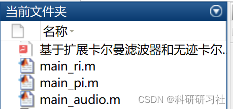
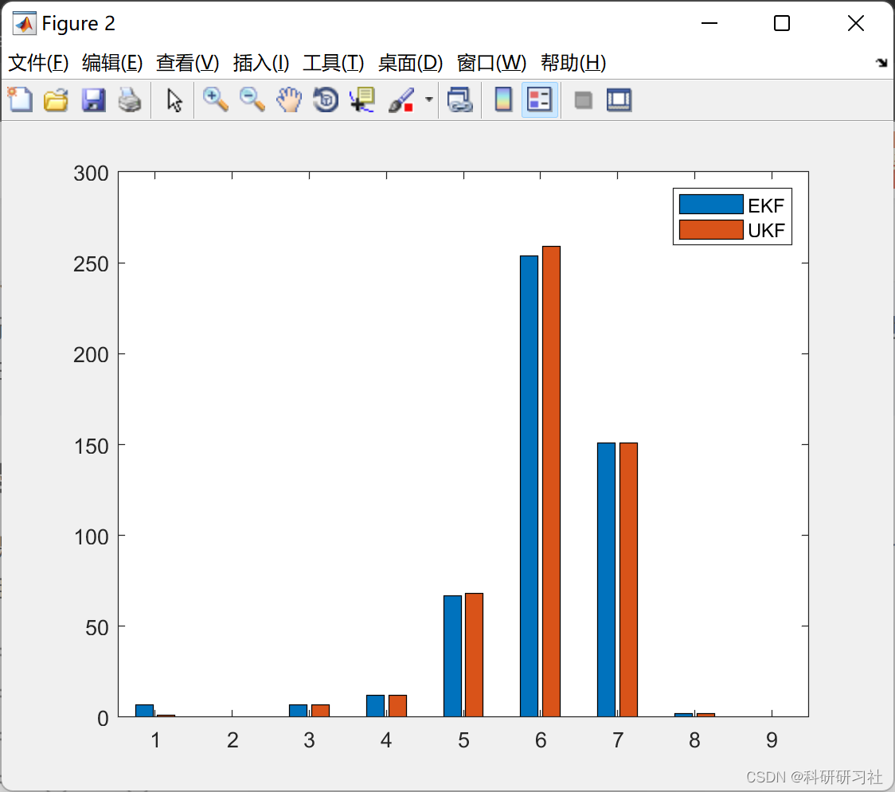

# [Signal Processing]Narrowband Signal Time-Varying Frequency Estimation Based on Extended Kalman Filter and Unscented Kalman Filter (Matlab Code Implementation)

Matlab version: 2018a
1. Overview of the paper explores and compares the capabilities of frequency tracking methods based on Kalman filters, such as the extended Kalman filter (EKF) and the unscented Kalman filter (UKF), to track time-varying frequencies of narrow band harmonic signals. These results are compared with those by Savaresi et al. in [3]. To evaluate the estimation quality of the algorithm implementation, two criteria were used: the performance index (PI) and the robustness index (RI), as described in [3]. An auxiliary convergence ratio was introduced to better interpret the PI plot. Considering two signals: a single-frequency sinusoidal signal recorded from real-world recordings and a noise signal generated with varying frequencies following an exponential distribution. The algorithm is able to estimate the real-world signal with an accuracy of ~10^-7 and achieves performance consistent with [3]. The results obtained are presented and discussed in the final section.
This paper discusses the problem of estimating the frequency of narrow-band harmonic signals with embedded noise; specifically, methods based on Kalman filters, such as the extended Kalman filter (EKF) and unscented Kalman filter (UKF). To evaluate the estimation quality of the algorithm implementation, two performance metrics are introduced: the Performance Index (PI) and Robustness Index (RI), along with an auxiliary convergence ratio. Tests have been conducted on recorded real-world signals and generated noise signals. The detailed article is available in Section 3.2. Mathematical Model The proposed model is constructed from a signal represented as a rotational vector in a Cartesian plane with angular velocity Φ(t). A three-order state space model (ARMA representation) is derived by projecting the vector along two axes and using the instantaneous frequency as state variables.
For detailed explanations, refer to Part 3.
3. Matlab code and detailed article explanation: This article only showcases a portion of the code, all the code and detailed articles can be accessed by clicking the following link:
Time-varying frequency estimation of narrowband signals based on extended Kalman filter and unscented Kalman filter (Matlab code implementation)
Editor
%% RI\nclear all\nclose all\nclc\nfclose('all');\n\nglobal logpath;\n\naddpath('./ukf')\naddpath('./ekf')\naddpath('./generate')\naddpath('./ri')\n\nPLOT_PREDICTION = false;\nPLOT_PROFILE = false;\nCOMPUTE = true;\n\n% Parameters\ninitial_omega = pi/2;\nstep_profile = [pi/11 -pi/5.5 pi/4 -pi/3.4 pi/2.8 -pi/2.5 pi/2 -pi/1.6 pi/1.4]; % Approximation of Fig.2 on the paper\nstep_length = 400;    \nsigma = 1e+1;\nq = 1e-5;\nr = sigma*q;\nn_simulations = 500;\ninitialization_noise_sigma = 0.001;\nthreshold = 120;\n% sigma_noise = 2e-2;\n% sigma_omega_noise = 1e-3;\nsigma_noise = 4e-1;\nsigma_omega_noise = 3e-1;\n\nif (PLOT_PREDICTION)\n    ri_figure = figure('visible','off');\n    set(ri_figure, 'Position', [0, 0, 720, 720],'Resize','off')\nend\n\nnamestring = sprintf('q%1.2e_s%1.2e_sn%1.2e_sno%1.2e',q,sigma,sigma_noise,sigma_omega_noise);\nlogpath = strcat(pwd,'\data\ri\',namestring,'\')\nif ~exist(logpath,'dir'), mkdir(logpath), end\n\nif (COMPUTE)\n    ri_ekf = zeros(1,n_simulations);\n    ri_ukf = ri_ekf;\n    for ii = 1:n_simulations\n        fprintf('***** Iteration %d *****\n',ii)\n        % Generate signal\n        [signal, omega]=generate_signal_step(step_length,initial_omega,step_profile,sigma_noise,sigma_omega_noise);\n\n        %% Track    \n        x_pred_0 = [0, 0, normrnd(omega(1),omega(1)*initialization_noise_sigma)]; % Initialization\n\n        pred_vec_ekf = ekf( ... \n            signal, ...%signal\n            x_pred_0, ...%x_pred_0\n            initialization_noise_sigma, ...%sigma_init\n            r, ... %r,\n            q ... %q\n        );\n        pred_vec_ukf = ukf( ... \n            signal, ...%signal\n            x_pred_0, ...%x_pred_0\n            initialization_noise_sigma, ...%sigma_init\n            r, ... %r,\n            q ... %q\n        );\n\n        % Take only the state we are interested in\n        pred_omega_ekf = pred_vec_ekf(3,:); \n        pred_omega_ukf = pred_vec_ukf(3,:); \n\n        disp('************ EKF *************');\n        ri_ekf(ii) = compute_ri(pred_omega_ekf,omega,step_length,threshold);\n        disp('************ UKF *************');\n        ri_ukf(ii) = compute_ri(pred_omega_ukf,omega,step_length,threshold);\n\n        % Plot ground truth and predictions\n        if PLOT_PREDICTION\n            set(0, 'currentfigure', ri_figure);\n            clf;\n            title('Predictions for RI');\n            t = 1:length(omega);\n            stairs(t, omega, 'k');\n            xlabel('Samples')\n            ylabel('Omega')\n            set(gca,'YLim',[0,pi]);\n            set(gca,'YTick',0:pi/4:pi);\n            set(gca,'YTickLabel',{'0' 'pi/4','pi/2','3/4pi','pi'});\n            hold on\n            plot(t,pred_omega_ekf,'ro');\n            plot(t,pred_omega_ukf,'bx');\n            legend('True','EKF','UKF')\n            RI(ii) = getframe;\n        end\n    end\n    \n    if (PLOT_PREDICTION)\n        generate_video(strcat('ri_',namestring),RI);\n    end\n\n    save(strcat(logpath,'ri_ekf.mat'),'ri_ekf')\n    save(strcat(logpath,'ri_ukf.mat'),'ri_ukf')\nelse\n    if exist('ri_ekf.mat','file') && exist('ri_ukf.mat','file')\n        load(strcat(logpath,'ri_ekf.mat'),'ri_ekf')\n        load(strcat(logpath,'ri_ukf.mat'),'ri_ukf')\n    else\n        error('No saved curves. Recompute.')\n    end\nend\n\nn_steps = length(step_profile);\nsteps_axis = 1:n_steps;\npsi_ekf = hist(ri_ekf, steps_axis);\npsi_ukf = hist(ri_ukf, steps_axis);\n\nif PLOT_PROFILE \n    figure(1)\n    hold off\n    stairs(omega)\n    xlabel('Samples')\n    ylabel('Omega')\n    set(gca,'YLim',[initial_omega-pi/2,initial_omega+pi/2]);\n    set(gca,'YTick',0:pi/4:pi);\n    set(gca,'YTickLabel',{'0' 'pi/4','pi/2','3/4pi','pi'});\nend\n\nri_figure = figure(2);\ntitle('RI')\nbar(steps_axis,[psi_ekf', psi_ukf'])\nlegend('EKF','UKF')\nsaveas(ri_figure, strcat(logpath,'ri_figure_',namestring,'.png'), 'png');\n  
4. Running Results Editing

## Images

<!-- PAYMENT_BLOCK -->

## Get this dataset

- Payment link (Stripe): [Buy now](https://buy.stripe.com/3cs8yP7sY87d0vu9AB)
- Payment QR code: 

<!-- /PAYMENT_BLOCK -->
